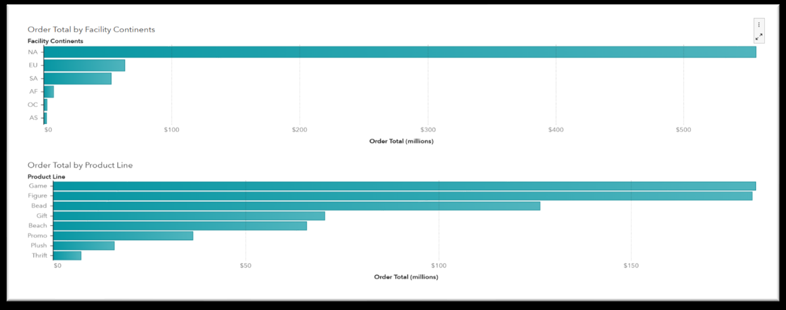
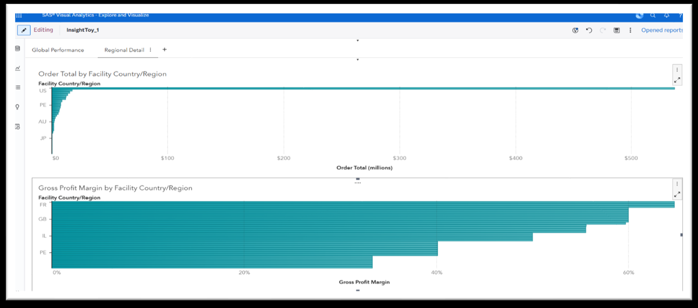
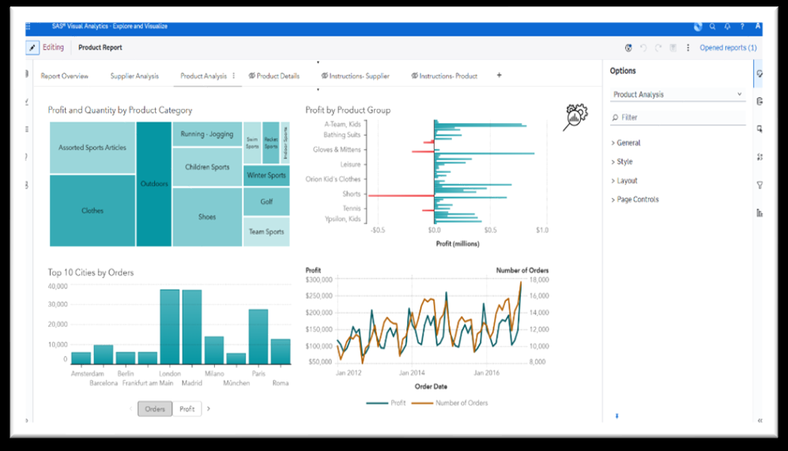

# SAS Viya Business Intelligence

An academic business-intelligence project using **SAS Viya / SAS Visual Analytics** to explore business data, evaluate dashboard design and create a two-page management report.

**Author:** Ali Hassan Anwar  
**Context:** MSc Data Analytics, Queen Mary University of London, 2026

[Read the case study](docs/CASE_STUDY.md) · [Download the PDF](docs/SAS_Viya_Business_Intelligence_Case_Study.pdf) · [Data and project scope](docs/DATA_AND_SCOPE.md)

## Project at a glance

| Component | My contribution | Evidence |
| --- | --- | --- |
| Orion Star product analysis | Reviewed an existing report, explored the source-table structure and explained the charts and interactions | Product dashboard, source-table and filter screenshots |
| Insight Toys management reporting | Created a two-page report moving from global performance to regional detail | Original Global Performance and Regional Detail screenshots |

The coursework used business scenarios. Orion Star and Insight Toys are presented here as academic cases, not as external client engagements.

## Insight Toys report

I organised the report around two questions: where does order value concentrate, and how do profitability patterns differ across countries?

### Global Performance



- North America has the largest order total in the displayed data.
- Game and Figure are the leading product lines by order total.
- The page gives a broad view before moving to country-level comparisons.

### Regional Detail



- The United States leads the displayed country-level order totals.
- France and Great Britain appear among the higher-margin markets.
- Order value and margin answer different questions, so both are needed before prioritising a market.

These are descriptive observations from the coursework report. They do not establish what caused the differences or measure the impact of a business decision.

## Orion Star report review



The original product table was shown in SAS with **951,669 rows and 30 columns**. I reviewed how the existing report used:

- a treemap to compare product categories;
- a horizontal bar chart to show product-group profit, including negative values;
- a city ranking with an Orders / Profit measure selector;
- a time-series view with separate axes for profit and order counts;
- category selections and object links to filter a related profit chart.

The [source-table screenshot](assets/orion-star-source-table.png) records the reported dataset size. The [Clothes](assets/orion-star-clothes-filter.jpg) and [Outdoors](assets/orion-star-outdoors-filter.jpg) screenshots show different category selections and the linked chart configuration.

The Orion Star dashboard was provided for analysis. I am claiming the review and interpretation, not authorship of that supplied dashboard.

## Skills demonstrated

SAS Viya · SAS Visual Analytics · Business intelligence · Exploratory data analysis · Report design · Data visualisation · Dashboard interpretation · Management reporting · Communication of findings

## What is included

```text
assets/     Original screenshots extracted from the coursework PDF
docs/       Case study, PDF and notes on data and scope
README.md   Project overview
```

The screenshots are the original report evidence, not recreated charts. The underlying SAS datasets and native editable SAS report files were not available in the supplied PDF and are not included. This repository is therefore a documented case study rather than a runnable SAS application.
