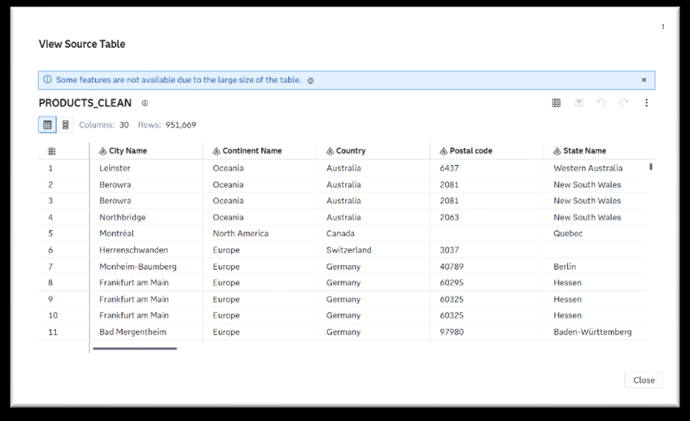
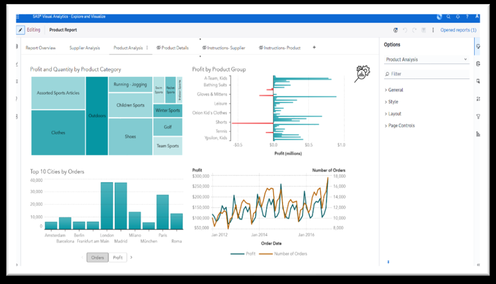
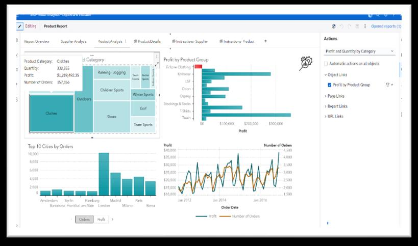
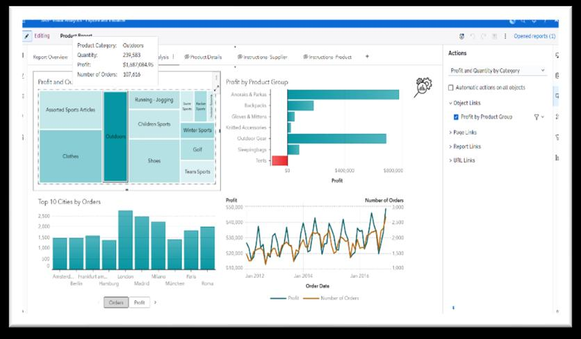
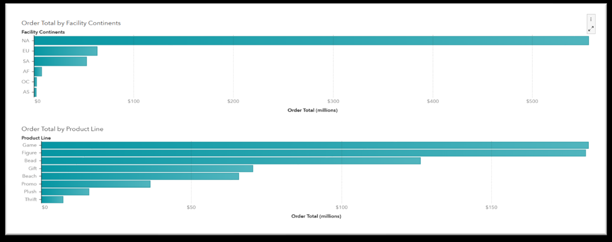
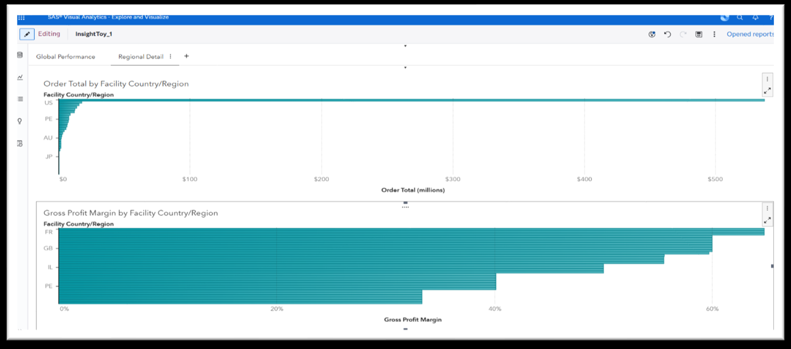

# SAS Viya Business Intelligence Case Study

## Purpose

This academic project explored how business-intelligence reports help users compare performance and investigate differences. It combined a review of an existing Orion Star product dashboard with an original two-page report for the Insight Toys coursework case.

The project was completed as part of MSc Data Analytics study at Queen Mary University of London in 2026.

## My contribution

For Orion Star, I explored the source-table structure, interpreted the supplied report and explained its visual and interactive design. For Insight Toys, I created the Global Performance and Regional Detail report pages and explained the sequence and chart choices.

## Orion Star product analysis

The SAS source-table view records 951,669 rows and 30 columns in PRODUCTS_CLEAN. The report brings together product categories, product groups, geographic information, dates and measures such as profit, quantity and order counts.

The original coursework noted some missing fields but did not provide missing-value counts or a full validation log. This portfolio does not claim an independently verified data-cleaning pipeline.

### Visual design

The treemap gives an overview of product categories. The horizontal profit chart makes loss-making groups visible; Shorts and Tennis appear below zero in the displayed report. The city chart provides a ranked comparison, with a selector to switch between Orders and Profit. The time-series view places profit and order activity on separate axes.

The charts support different questions. A large category may drive substantial volume, while a smaller product group may still require attention because it is loss-making. Geographic and time views provide further context before investigating prices, costs or demand.

### Interactions

The screenshots show a category selection in the treemap and an object link configured to the product-group profit chart. This lets a user focus on a category without creating a separate report. The implementation described in the coursework uses the Actions pane to choose the source and target objects.

## Insight Toys management report

I selected a global-to-regional storyline for a two-page report using INSIGHTTOY_SALES. The first page compares continents and product lines. The second page compares countries and gross profit margins.

### Global Performance

North America has the highest displayed order total. Game and Figure lead the product-line comparison. These observations identify the parts of the sample business that warrant closer commercial analysis; they do not show why those segments perform differently.

### Regional Detail

The United States leads the country-level order-total view. France and Great Britain appear among the higher-margin markets. Comparing order value with margin helps separate scale from relative profitability.

I used bar charts for the management report because the task required comparisons between categories. The two-page sequence keeps the overview separate from the more detailed market comparison.

## Questions for further analysis

- Do product mix, pricing or cost differences explain the margin variation between markets?
- How do profit and margin compare across the leading product lines?
- What changes over time are hidden by the aggregate geographic rankings?
- What is the reason for the loss-making Orion Star product groups?

These are follow-up questions, not findings established by the current analysis.

## Scope and limitations

The material is based on the supplied coursework PDF and its original screenshots. Exact chart values are not reconstructed from pixels. The original datasets and editable SAS report files are not included, so the static report cannot be independently rerun from this repository alone.

The published case study removes assignment questions, marking instructions and the student identifier. It retains the author name, academic context and original visual evidence. For file-level details, see [Data and project scope](DATA_AND_SCOPE.md).
